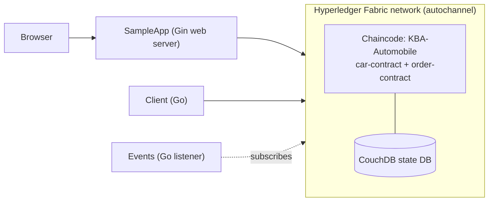

# KBA-Automobile

**A blockchain-based automobile management system built on Hyperledger Fabric and Go.**


KBA-Automobile uses smart contracts (chaincode) on a permissioned Hyperledger Fabric network to manage automobile records and order-related operations. It ships with a Go client, a chaincode event listener, and a Gin-powered web app, so you can see the full path from a browser click to a committed ledger transaction.

> **Repository:** [Adarshsivantk/hyperledger-fabric-automobile](https://github.com/Adarshsivantk/hyperledger-fabric-automobile)

## Table of Contents

- [Features](#features)
- [Architecture](#architecture)
- [Tech Stack](#tech-stack)
- [Project Structure](#project-structure)
- [Prerequisites](#prerequisites)
- [Getting Started](#getting-started)
- [Usage](#usage)
- [Data Model](#data-model)
- [Security Considerations](#security-considerations)
- [Roadmap](#roadmap)
- [Contributing](#contributing)
- [License](#license)

## Features

- **Automobile management**: create and manage automobile records through smart contract operations.
- **Order management**: order-related business logic in a separate smart contract.
- **Permissioned network**: uses Fabric's identity and membership model.
- **Chaincode events**: a listener that reacts to events emitted by transactions.
- **CouchDB indexing**: index configuration for efficient rich queries.
- **Private data collections**: restrict sensitive data to authorized organizations.
- **Go client**: a dedicated client for submitting and evaluating transactions.
- **Web interface**: browser UI backed by a Go (Gin) server.

## Architecture

The application is split into independent components that all talk to the same Fabric network.



| Component | Directory | Responsibility |
|---|---|---|
| Chaincode | `Chaincode/` | Smart contracts for cars and orders, private data collections, CouchDB index |
| Client | `Client/` | Go application that submits transactions to the contracts |
| Events | `Events/` | Listens for and handles chaincode events |
| Web app | `SampleApp/` | Gin server plus HTML/CSS/JS frontend |

## Tech Stack

| Layer | Technology |
|---|---|
| Blockchain platform | Hyperledger Fabric |
| Smart contracts | Go |
| Backend applications | Go |
| Web framework | Gin |
| Frontend | HTML, CSS, JavaScript |
| State database | CouchDB |
| Containerization | Docker |
| Dependency management | Go Modules |

## Project Structure

```text
KBA-Automobile/
├── Chaincode/
│   ├── META-INF/statedb/couchdb/indexes/
│   │   └── indexCarId.json      # CouchDB index
│   ├── car-contract.go          # Automobile contract
│   ├── order-contract.go        # Order contract
│   ├── collections.json         # Private data collections
│   ├── main.go                  # Chaincode entry point
│   ├── go.mod
│   └── go.sum
├── Client/                      # Transaction client
│   ├── client.go
│   ├── connect.go
│   ├── profile.go
│   ├── main.go
│   ├── go.mod
│   └── go.sum
├── Events/                      # Chaincode event listener
│   ├── event.go
│   ├── connect.go
│   ├── profile.go
│   ├── main.go
│   ├── go.mod
│   └── go.sum
├── SampleApp/                   # Web application
│   ├── public/{scripts,styles}/
│   ├── templates/index.html
│   ├── client.go
│   ├── connect.go
│   ├── profile.go
│   ├── main.go
│   ├── go.mod
│   └── go.sum
└── README.md
```

Each of `Chaincode`, `Client`, `Events` and `SampleApp` is its own Go module.

## Prerequisites

- **Go**, matching the version in each component's `go.mod`
- **Docker Engine** and **Docker Compose**
- **Hyperledger Fabric** binaries and Docker images ([install guide](https://hyperledger-fabric.readthedocs.io/))
- **Git**
- A running Fabric network with organizations, peers, an ordering service and a channel
- Fabric identities, TLS certificates and connection profiles for your organizations

## Getting Started

### 1. Clone the repository

```bash
git clone https://github.com/Adarshsivantk/hyperledger-fabric-automobile.git
cd hyperledger-fabric-automobile
```

### 2. Start a Fabric network

Set up the network separately from this repo (for example with Fabric's `test-network`). The applications expect:

| Setting | Value |
|---|---|
| Channel | `autochannel` |
| Chaincode name | `KBA-Automobile` |

### 3. Deploy the chaincode

From your Fabric `test-network` directory, bring up the network with CouchDB, create the channel, then deploy the chaincode from this repo's `Chaincode/` directory. Example (adjust paths to your machine):

```bash
cd fabric-samples/test-network

./network.sh up createChannel -c autochannel -ca -s couchdb

./network.sh deployCC \
  -c autochannel \
  -ccn KBA-Automobile \
  -ccp /path/to/hyperledger-fabric-automobile/Chaincode \
  -ccl go \
  -cccg /path/to/hyperledger-fabric-automobile/Chaincode/collections.json
```

> These flags follow Fabric's standard `test-network` script. Confirm they match your Fabric version and setup, since scripts differ between releases.

Confirm the chaincode is committed on `autochannel` before continuing.

### 4. Configure connectivity

Review `connect.go` and `profile.go` in `Client/`, `Events/` and `SampleApp/`, and set:

- Connection profile paths
- Organization identities
- Peer TLS certificates
- Network endpoints
- Channel and chaincode names

> Never commit private keys, wallets or credentials.

### 5. Download dependencies

Run these from the repository root. Each runs in its own subshell, so a failure in one doesn't affect the paths of the others.

```bash
(cd Chaincode && go mod download)
(cd Client && go mod download)
(cd Events && go mod download)
(cd SampleApp && go mod download)
```

## Usage

Run each component in its own terminal.

**Client**

```bash
cd Client
go run .
```

**Event listener** (keep it running to watch events)

```bash
cd Events
go run .
```

**Web application**

```bash
cd SampleApp
go run .
```

If the server listens on port 8080, open <http://localhost:8080>.

The Fabric network must be up and the connection configuration correct, otherwise the applications cannot connect.

## Data Model

**Automobile records** include: automobile ID, make, model, color, manufacturer and date of manufacture.

**Order records** are handled by the operations defined in `order-contract.go`.

**CouchDB index**: `Chaincode/META-INF/statedb/couchdb/indexes/indexCarId.json` supports state database queries.

**Private data collections**: `Chaincode/collections.json` defines which organizations can access private data. Access depends on collection membership and Fabric policies.

## Security Considerations

- Never commit private keys, wallet identities, passwords or credentials.
- Protect connection profiles and sensitive configuration files.
- Set membership and endorsement policies appropriately.
- Validate inputs before submitting transactions.
- Use TLS and proper access controls.
- Review private data collection membership before deploying.

## Roadmap

- [ ] Advanced automobile search and filtering
- [ ] Expanded order management
- [ ] Better request validation and error handling
- [ ] Automated tests for chaincode and APIs
- [ ] Authentication and role-based authorization
- [ ] Monitoring and deployment automation

## Contributing

Contributions, bug reports and suggestions are welcome.

1. Fork the repository
2. Create a feature branch: `git checkout -b feature/my-change`
3. Commit and push your changes
4. Open a pull request

Please test your changes, document new dependencies, and keep sensitive configuration out of commits.

## License

No license has been specified yet. Add a `LICENSE` file (for example MIT or Apache-2.0) if you want others to be able to use and distribute this project.